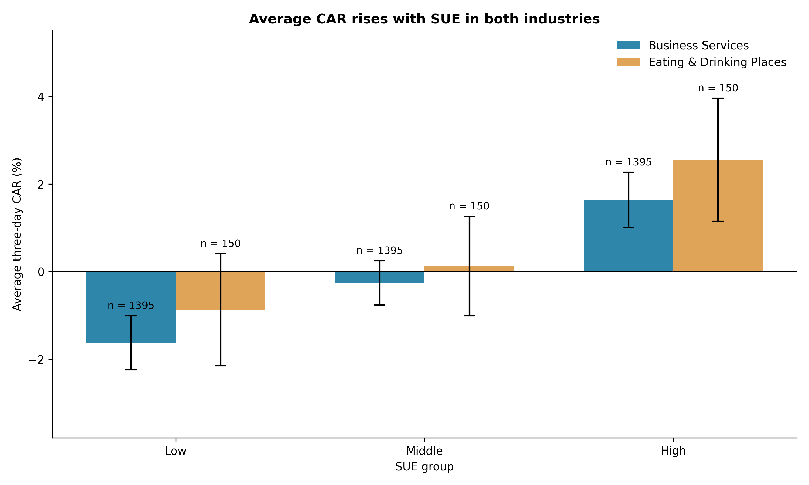
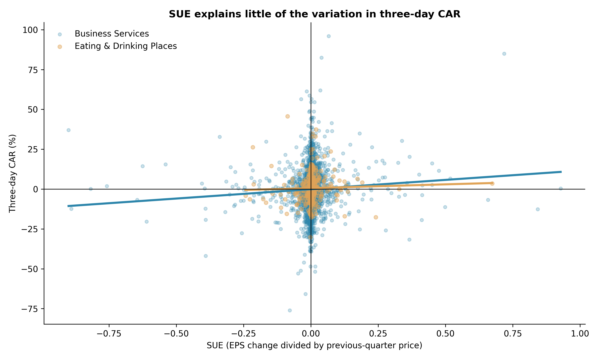
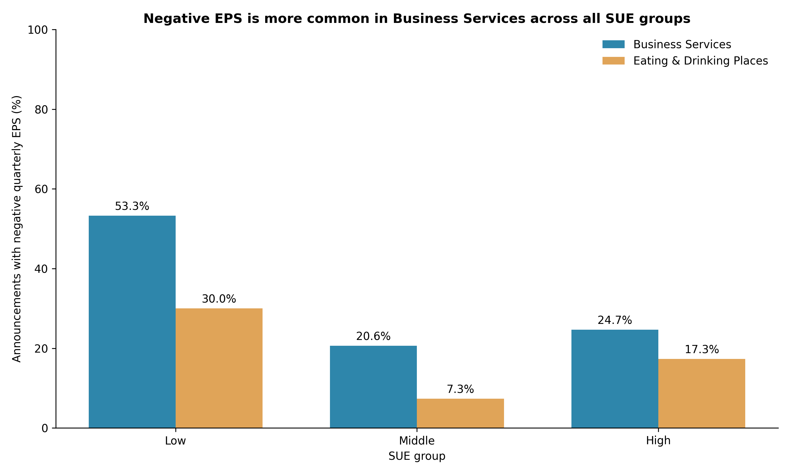

# Earnings Surprises and Stock Reactions across Two Industries

**Author:** Jenna Beauchain · BAN 4550, Fall 2026 · Industry: Business Services, SIC 73 · Comparison industry: Eating & Drinking Places, SIC 58 · Client: Microsoft

## The question
Microsoft wants to look at quarterly earnings announcements and understand the reaction of the stock market around them. Are larger earnings surprises associated with higher abnormal returns in the Business Services sector, and how does this compare with the Eating & Drinking Places sector?

## Main result
Comparing the Business Services and Eating and Drinking Places both have average three-day abnormal return (CAR) that increase from Low to High. The gap between High and Low for Business Services is 3.261 percentage points and 3.426 for Eating & Drinking Places. However, insufficient evidence that the SUE-CAR relationship differs (p=0.497) was found using the direct slope comparison.



## Is the difference real?
The t-test (difference, t-statistic, p-value) and the regression (b, p-value, R²) for each industry, in plain words, then Figure 2. If you ran more than one model, say in one sentence whether b changed.
The Welch t-tests compare average CAR in the High and Low SUE groups within each industry:

- **Business Services:** The High group has an average CAR 3.261 percentage points above the Low group (t = 7.216, p = 6.89 × 10⁻¹³).
- **Eating & Drinking Places:** The difference is 3.426 percentage points (t = 3.528, p = 0.000485).

Both differences are statistically significant, although these tests treat announcements as independent observations even when companies appear more than once.

The baseline regressions use individual SUE values rather than the three groups. The following p-values use **ordinary standard errors**:

- **Business Services:** The slope is b = 0.1171 (p = 0.0000319), and R² = 0.0041. The positive relationship is statistically significant, but SUE explains only 0.41% of the variation in three-day CAR.
- **Eating & Drinking Places:** The slope is b = 0.0475 (p = 0.498), and R² = 0.0010. The relationship is not statistically significant, and SUE explains only 0.10% of the variation in three-day CAR.

Using **company-clustered standard errors** leaves the baseline slopes unchanged: Business Services remains significant at the 5% level, while Eating & Drinking Places does not. Adding fiscal-year effects changes the slopes only slightly, to 0.1201 and 0.0515, respectively; allowing the slope to differ for negative-EPS announcements produces positive-EPS slopes of 0.2970 and 0.1779, so these interaction-model coefficients apply to a different subgroup.

A separate pooled regression directly tests the difference between the industries' baseline slopes using company-clustered standard errors. The estimated difference, Eating & Drinking Places minus Business Services, is −0.0696 (p = 0.497; 95% confidence interval: −0.2704 to 0.1312). This provides insufficient evidence that the slopes differ; it does not establish that they are equal.

Figure 2 below plots SUE against the three-day CAR, with one regression line for each industry. The wide scatter around both lines is consistent with the low R² values.



## Why the industries differ
One possible reason why Business Services and Eating and Drinking Places industries differ is because Business Services had more announcements with negative quarterly earnings per share (EPS). Figure 3 shows that negative EPS was more common in Business Services than in Eating & Drinking Places in every single earnings surprise group (SUE). This gap was the largest in the LOW SUE group, comparing 53.26% with 30.00%. The middle and high group also showed gaps, comparing 20.65% with 7.33% and 24.66% and 17.33% respectively. This shows a difference in sample composition, but it does not prove that negative EPS explains the market reactions.




## Advice for the client
- **Business implication:** When Microsoft looks at how its stock moved after an earnings release, it should consider both the results it reported and what it told investors to expect next. Even though companies in the higher earning-surprise group had a better average of three-day returns, individual stocks could still fall so it's important to look at all factors reported.
- **Limitation:** One limitation is that several pieces of news or information can come out around the same time. This means that the analysis cannot isolate one specific factor that drove the stock reaction. In addition, the comparison of the industries is also less precise because Eating & Drinking Places had 450 announcements compared to the 4,185 announcements Business Services had.
- **Next questions:** 
Predictive Question: Can we help predict Microsoft's three-day stock reaction by knowing what the analysts expected and what management said about the outlook? (collect analyst EPS estimates and management outlooks for each announcement)
Prescriptive Question: How can Microsoft make its quarterly results and outlook easier for investors to understand? (create different ways of presenting the information and use surveys to check what people understood.)

## Data
- **Sources:** I accessed quarterly EPS, quarterly closing prices, fiscal periods, and announcement dates through WRDS using Compustat (`comp.fundq`). CRSP supplies daily stock returns (`crsp.dsf`) and market returns and the trading calendar (`crsp.dsi`). The instructor-provided `ccm_link.csv` connects Compustat companies to CRSP stocks and supplies industry identifiers and valid link dates.
- **The data are not included in this repository** because of the WRDS license. Someone with the required WRDS access can rebuild the results by running the notebook with the instructor's link file in the notebook folder.
- **Sample:** Each final row represents one company-quarter earnings announcement. The sample covers January 1, 2021–December 31, 2024 for Business Services (SIC 73) and Eating & Drinking Places (SIC 58). Quarterly data are pulled from January 2019 through December 2024 to provide historical EPS and prices; daily returns are pulled from December 2020 through January 2025 to cover event windows near the sample boundaries. The final samples contain 4,185 and 450 announcements, respectively.
- **Filters:** I apply the same rules to both industries: a known announcement date within the sample period; available current EPS, EPS four quarters earlier, and previous-quarter price; a previous-quarter price of at least $5; absolute SUE no greater than 1; a valid dated company–stock link; and all three daily abnormal returns. The $5 threshold excludes low-priced stocks and ensures a positive denominator; duplicate keys are handled as documented in the notebook.
- **Data Availability:** WRDS records and the instructor's link file are excluded from GitHub. Reproduction requires the necessary WRDS access and `ccm_link.csv` in the notebook folder. The repository contains code, aggregate results, and figures.

## How the tables fit together
I performed 5 merges starting with joining th quarterly records in comp.fundq and the valid links in ccm_link.csv using the gvkey. Next I merged that result with the EPS from 4 quarters ago, using a left join. The same was done for the previous-quarter price in the next merge. Next, the daily stock returns were joined with the market returns. Lastly, the three required trading days were matched with the previous table. Day 0 is the first trading day on or after rdq, meaning that weekend/holiday announcements are moved to the next trading day. 


## How I checked the results
I checked whether a few extreme stock reactions drove the Business Services results. I did this by removing those five announcements and re-created the SUE groups to see if anything had changed. I found that the average CAR still increased from Low to Middle to High, meaning those 5 extreme observations do not explain the pattern alone.

## Changes since Project 2
| What was wrong | How I fixed it | How the results changed |
|I didn't state whether the merge was one-to-one or one-to-many in the merge map. Need to also explain that day 0 is the first trading day on or after rdq.  | Added these relationships and descriptions to the README and merge map. | This only changed documentation; no effect on the calculations or code. |
|Explanation of duplicate sources lacked detail. |Added more detail to slides and explanations regarding duplicate-handling practices. |This only changed documentation; no effect on the calculations or code. |
|How weekend announcements are handled was not explained. |Added more detail to sections pertaining to this topic. |This only changed documentation; no effect on the calculations or code.|
|Events explaining LIVE and INOD were missing. |This feedback only concerns the Project 2 write-up, so these changes cannot be seen in this README. |This only changed documentation; no effect on the calculations or code. |

## Where the code came from
This code adapts from my instructor's class notebooks including: 

| AI tool | Link (or PDF in docs/) | What I used it for |
|ChatGPT |https://chatgpt.com/share/6b04e91f-45c8-83e9-a025-7d5c658ebe51 | This link shows all AI use for all sections of this project. AI was used to assist in planning, writing code, checking requirements, answering questions, and understanding results. |

## Files

```text
notebooks/   Beauchain_Jenna_Project3.ipynb (runs top to bottom on WRDS JupyterHub)
figures/     figure1_industry_comparison.png
             figure2_sue_car_regression.png
             figure3_negative_eps_share.png
             merge_map.png
docs/        Beauchain_Jenna_Project3.pdf (presentation slides)
README.md
```
